# PM2ExamenGrupo5 – Contactos con firma digital y GPS

Examen del segundo parcial de Programación Móvil I (PMO-0602). Una API REST en C# guarda contactos con su firma digital en PNG y su ubicación GPS. Una aplicación Android en Java la consume con Retrofit.

## Integrantes – Grupo 5

| Nombre | Número de cuenta |
|---|---|
| Carlos Roberto Cárdenas Martínez | 202430010599 |
| Jennifer Mariela Márquez Chacón | 202330010411 |
| José Fernando Orellana Reyes | 202210010352 |
| Michael Abad Díaz Castro | 202310040165 |
| Romel Márquez | 202410010359 |
| Fernando Abad Diaz Castro | 202410040257 |

## Tecnología asignada

| Requisito | Valor |
|---|---|
| Librería de red | Retrofit 2.11 con GsonConverterFactory y OkHttp |
| MIME del archivo | `image/png` |
| Tamaño máximo | 1 MB |
| API | ASP.NET Core 8 Web API, Entity Framework Core 8 con SQLite, arquitectura limpia, Swagger |
| App | Java, Activities, FusedLocationProviderClient, osmdroid (OpenStreetMap) |

## URL base de la API

| Entorno | URL |
|---|---|
| API publicada | `https://api2.orellanawebhostin.space/` |
| Local en la PC (Postman y Swagger) | `http://localhost:5080` |
| Celular o emulador conectado por USB (`adb reverse tcp:5080 tcp:5080`) | `http://localhost:5080` |

La app toma la URL de la propiedad `apiBaseUrl` en `gradle.properties`. Para usar la API publicada se cambia esa línea por la URL pública, terminada en `/`, y se vuelve a instalar la app.

## Endpoints

| Método | Ruta | Descripción | Respuestas |
|---|---|---|---|
| POST | `/api/contactos` | Crea un contacto. `multipart/form-data` con `nombre`, `telefono`, `latitud`, `longitud` y `archivo` (PNG). | 201, 400, 415 |
| GET | `/api/contactos?buscar=` | Lista los contactos; `buscar` filtra por nombre o teléfono. | 200 |
| GET | `/api/contactos/{id}` | Obtiene un contacto. | 200, 404 |
| GET | `/api/contactos/{id}/archivo` | Descarga la firma con `Content-Type: image/png`. | 200, 404 |
| PUT | `/api/contactos/{id}` | Actualiza los datos. `multipart/form-data`; `archivo` es opcional. | 200, 400, 404, 415 |
| DELETE | `/api/contactos/{id}` | Elimina el contacto y su archivo. | 204, 404 |

El archivo se guarda en la carpeta `Archivos` del servidor; la base de datos guarda solo la ruta, el MIME type y el tamaño. Los errores se devuelven en JSON (`ProblemDetails`) y la app muestra el campo `detail`.

## Estructura

```
PM2ExamenGrupo5/
├── ContactosApi/
│   ├── Contactos.sln
│   ├── postman/                      colección, entorno y archivos de prueba
│   └── src/
│       ├── Contactos.Domain/         entidad Contacto
│       ├── Contactos.Application/    DTOs, interfaces, validaciones y ContactoService
│       ├── Contactos.Infrastructure/ EF Core (SQLite), repositorio y almacenamiento de archivos
│       └── Contactos.Api/            controlador, middleware de errores, Swagger
├── app/                              aplicación Android (Java)
└── docs/capturas/                    capturas de la app, Swagger y Postman
```

## Cómo ejecutar

### API
```powershell
cd ContactosApi
dotnet run --project src\Contactos.Api
```
La base de datos `contactos.db` y la carpeta `Archivos` se crean solas al iniciar. Swagger queda en `http://localhost:5080/swagger`.

### Publicar la API
```powershell
cd ContactosApi
dotnet publish src\Contactos.Api -c Release -o publicar
```
Se sube el contenido de la carpeta `publicar` a un hosting que soporte ASP.NET Core 8 y permita escribir en la carpeta de la aplicación (ahí se crean `contactos.db` y `Archivos`). La URL publicada debe usar `https://`. Después se prueba en `https://api2.orellanawebhostin.space/swagger`.

### Postman
1. Importe `ContactosApi/postman/PM2ExamenGrupo5.postman_collection.json` y `PM2ExamenGrupo5.postman_environment.json`.
2. Seleccione el entorno **PM2 Examen Grupo 5 - Local**. Para probar la API publicada, cambie `baseUrl` por la URL pública.
3. En **Settings → General → Working directory** elija la carpeta `ContactosApi/postman`, para que encuentre los archivos de prueba.
4. Ejecute la colección en orden con **Run collection**.

### App Android
1. Abra la carpeta raíz del proyecto en Android Studio y sincronice Gradle.
2. La app usa por defecto la API publicada `https://api2.orellanawebhostin.space/` (propiedad `apiBaseUrl` en `gradle.properties`), así que funciona desde cualquier red con internet.
3. Para usar la API local, cambie `apiBaseUrl` a `http://localhost:5080/`, conecte el celular por USB con la depuración USB activa (o abra un emulador con Google Play) y ejecute `adb reverse tcp:5080 tcp:5080`.
4. Ejecute la app y acepte los permisos de ubicación y de red local. Si el GPS está apagado, la app pide activarlo.
5. En el emulador, la ubicación se cambia en **⋮ → Location**.

## Funcionalidad

| Pantalla | Funciones |
|---|---|
| 1. Registro | Firma digital en un lienzo (Canvas y Path), nombre, teléfono, latitud y longitud en tiempo real (bloqueadas), validaciones, envío del PNG por POST multipart. |
| 2. Contactos salvados | Lista (GET), búsqueda con texto, ver la firma descargada de la API, actualizar (PUT) y eliminar (DELETE). Al tocar un contacto pregunta si desea ir a su ubicación. |
| 3. Mapa | Muestra el punto del contacto con un marcador en OpenStreetMap. |

Cada petición muestra un indicador de carga. Si la API no responde aparece **"Sin conexión con la API. Intente de nuevo."** con la opción **Reintentar**.

## Capturas

### Aplicación Android

| | | |
|:---:|:---:|:---:|
| **Registro con firma y ubicación GPS**<br>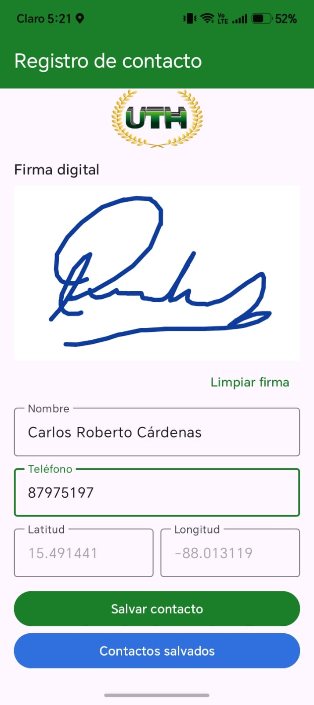 | **Contacto guardado (POST)**<br>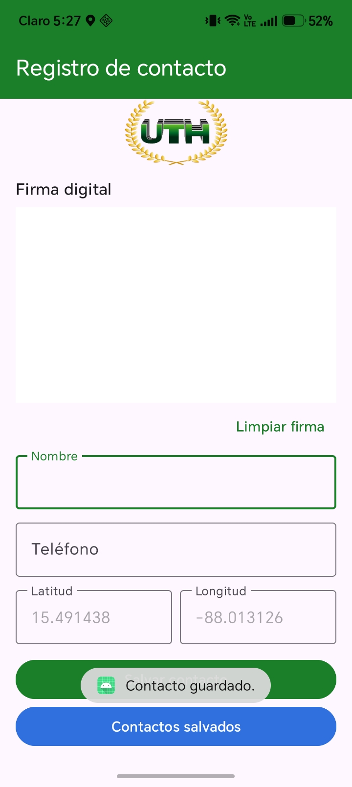 | **Validación: firma no capturada**<br>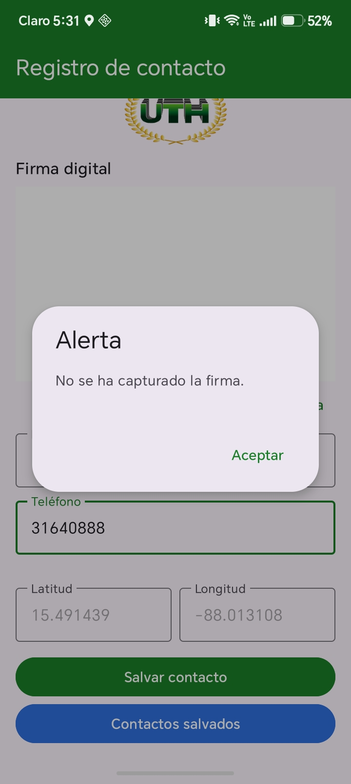 |
| **Validación: teléfono inválido**<br>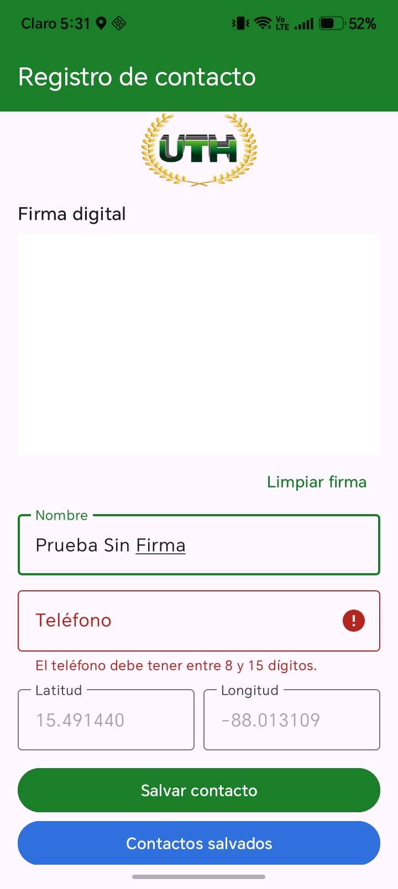 | **Lista de contactos (GET)**<br>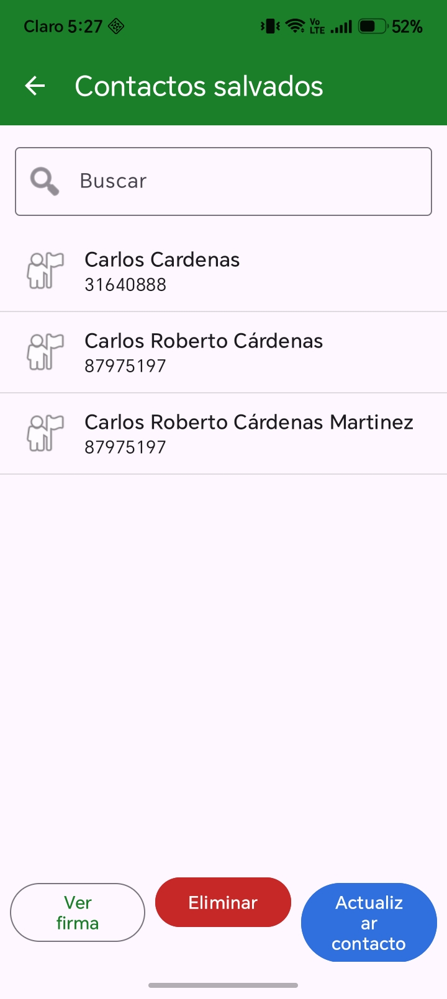 | **Búsqueda por texto**<br>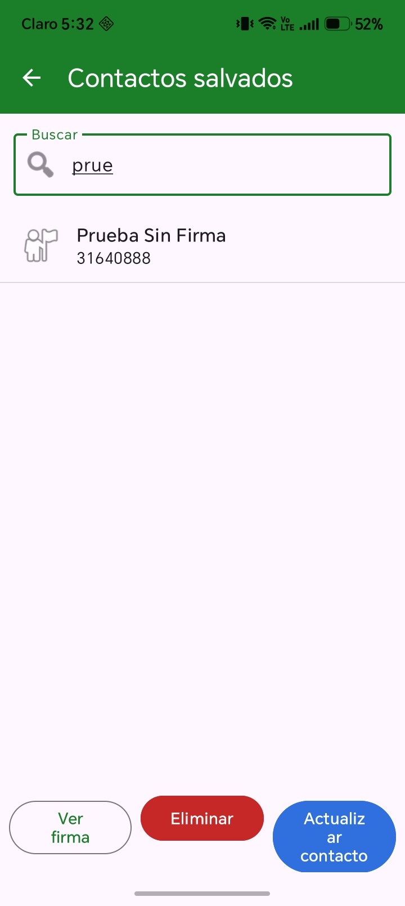 |
| **Ver firma descargada de la API**<br>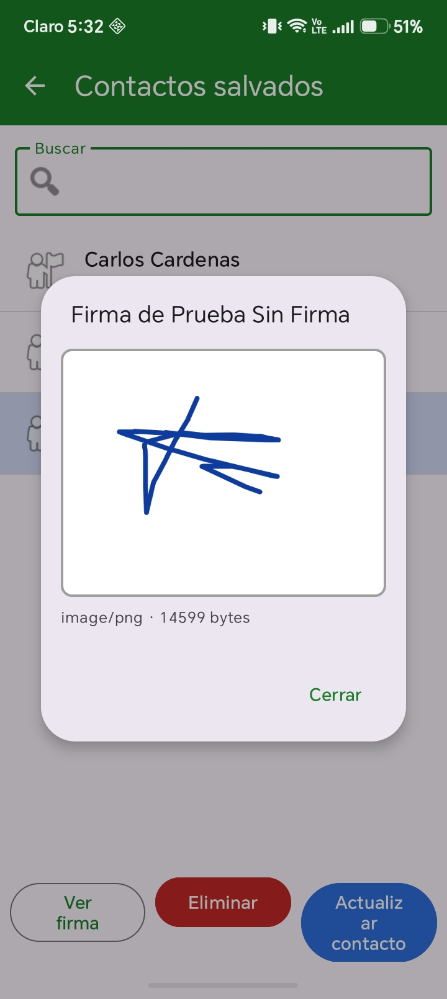 | **¿Desea ir a la ubicación?**<br>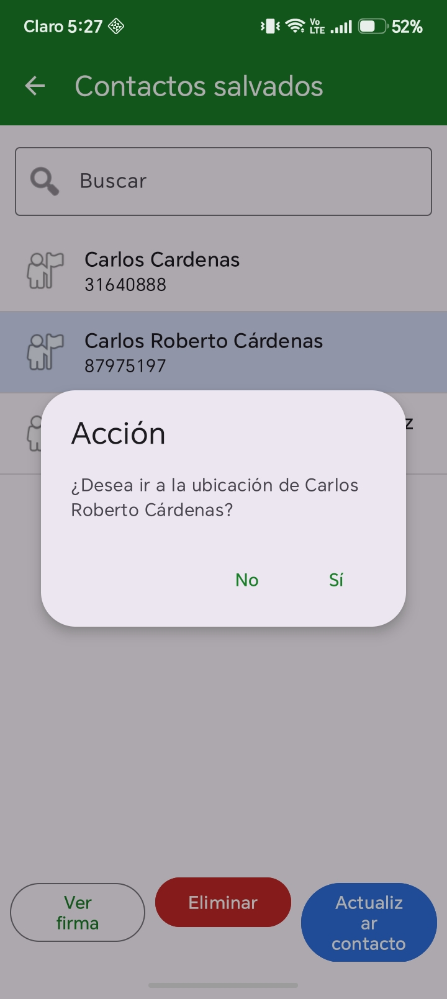 | **Mapa con el punto del contacto**<br>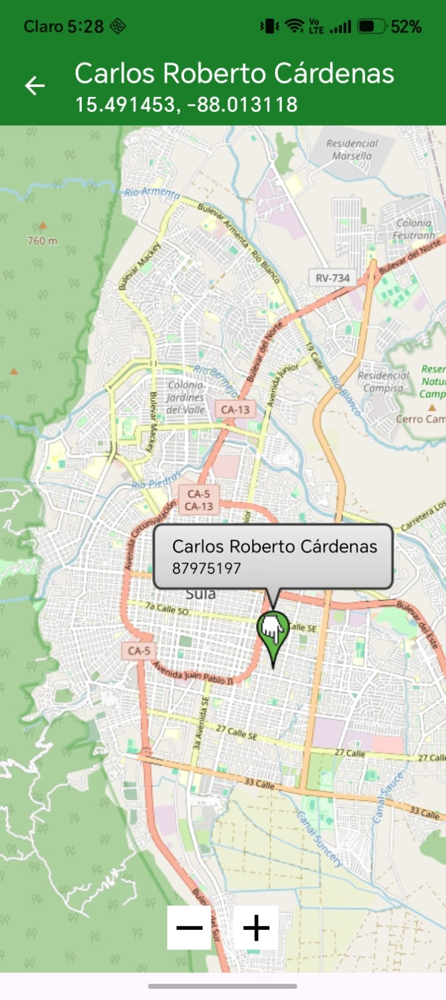 |
| **Actualizar contacto (PUT)**<br>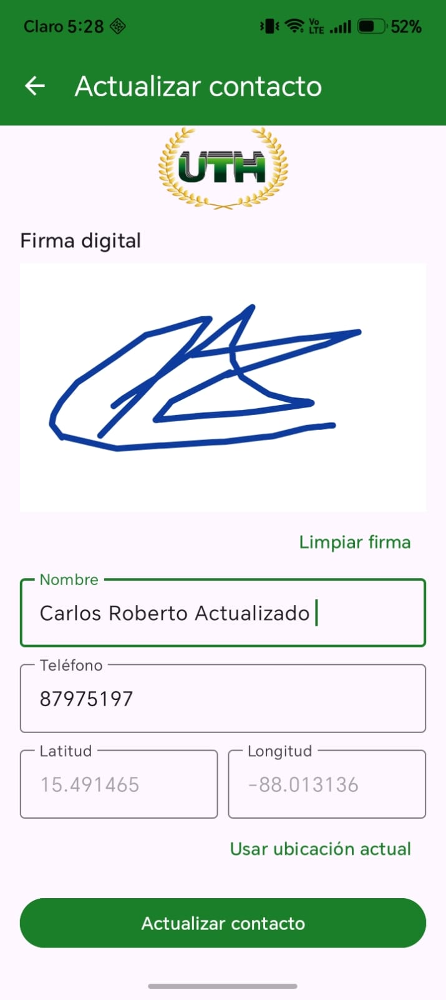 | **Contacto actualizado**<br> | **Confirmar eliminación**<br> |
| **Contacto eliminado (DELETE)**<br>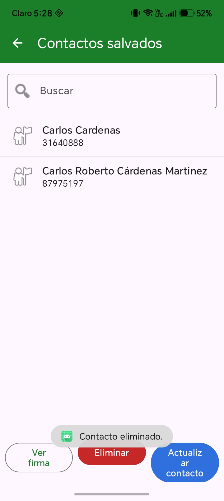 | **Sin conexión con la API y Reintentar**<br>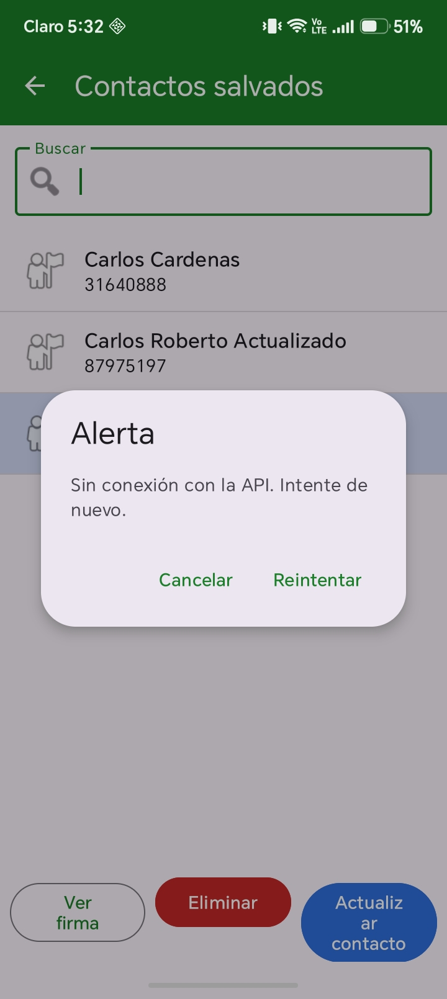 |  |

### Swagger

**Endpoints de la API**


**POST multipart con la firma: 201 Created**


**GET por id: 200 OK**


### Postman

**Ejecución de la colección: 16 pruebas aprobadas, 0 fallidas**


